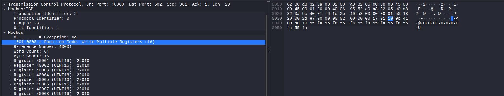
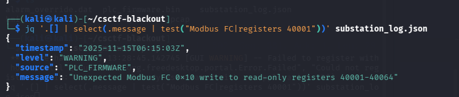
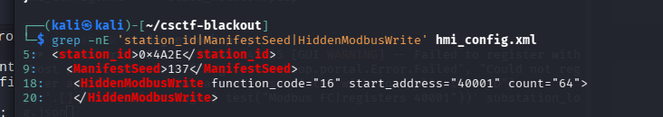
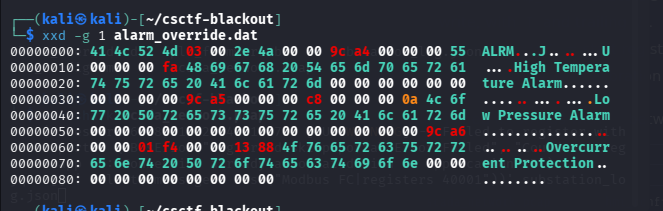
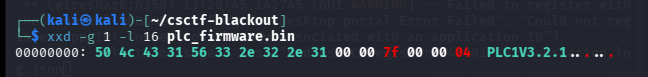

# Operation Blackout (ICS, 708 points)

> **Solved:** The submitted marker was accepted. Final interview notes and review are pending.

## Challenge

An offline ICS-forensics case about a power outage at substation `0x4A2E`. The provided evidence includes a SCADA packet capture, HMI configuration, PLC firmware, a substation event log, and an alarm override file. The task is to correlate the artifacts and derive a marker from five specified values.

## Approach

I treated the case as a cross-source incident reconstruction. I checked whether the network capture, event log, HMI configuration, firmware, and alarm override agreed before using any value in the marker.

## Solution

### Inspecting the Modbus/TCP request

In Wireshark, I inspected a Modbus/TCP request with function code 16, which writes multiple registers. The packet shows a write beginning at register `40001`, with a claimed word count of `64`. Its destination is `192.168.50.10:502`, matching the PLC address configured in the HMI file. The visible register values are `22010` (`0x55FA`), matching the repeated `55 FA` pattern shown in the HMI configuration.

The request reports a byte count of `16`, which does not match a 64-register write (128 data bytes). This is an inconsistency to correlate with the incident log and other artifacts.



### Correlating the event log

I used `jq` to select the log entry mentioning the FC16 write. The event is timestamped `2025-11-15T06:15:03Z` and reports an unexpected write to read-only registers `40001-40064`. This matches the start register and claimed range in the packet.



### Checking the HMI configuration

The HMI configuration identifies station `0x4A2E`, sets the manifest seed to `137`, and defines a hidden FC16 write starting at register `40001` with count `64`. These details agree with the station in the incident brief and the register range in the packet and log.



### Inspecting the alarm override

I used `xxd` to inspect the binary override file. Its readable labels and adjacent values correspond to the alarm changes recorded in the log: high temperature changes from `85` to `250`, low pressure from `200` to `10` (the log expresses these as `2.0` to `0.1` bar), and overcurrent from `500` to `5000`. This supports the conclusion that the override belongs to the same incident.



### Reading the firmware header

I used `xxd` to inspect the first bytes of the PLC firmware. The first four bytes are `50 4c 43 31`, so the serialization value is `0x504C4331`. The readable version string follows the header and is not used in the marker.



## Dead ends

No challenge-specific dead ends have been reported yet. Add any real attempts that did not work, or state that there were none.

## Flag

The serialized input was:

```text
0x504C4331:0x4A2E:2025-11-15T06:15:03Z:40001:137
```

I calculated its SHA-256 digest:

```text
12fcdb0d35f7fde4685d2f6995958f107ec9b5dd8a2ffd74e8fd44a6ff8ea85b
```

The flag is `CSCTF{12fcdb0d}`. I submitted it and confirmed that it was correct.

## Takeaway

I learned to compare network activity with configuration, event logs, and binary evidence before attributing an ICS incident to a specific write. The malformed register count and byte count were useful indicators to validate across sources.
