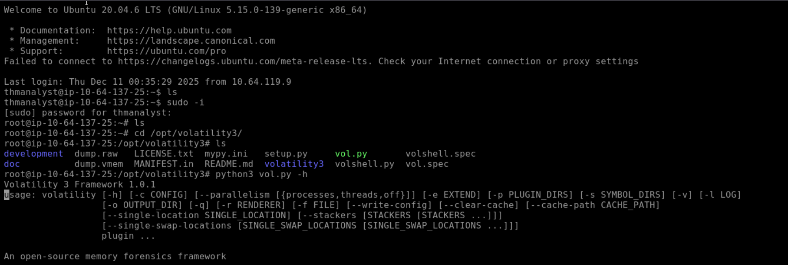
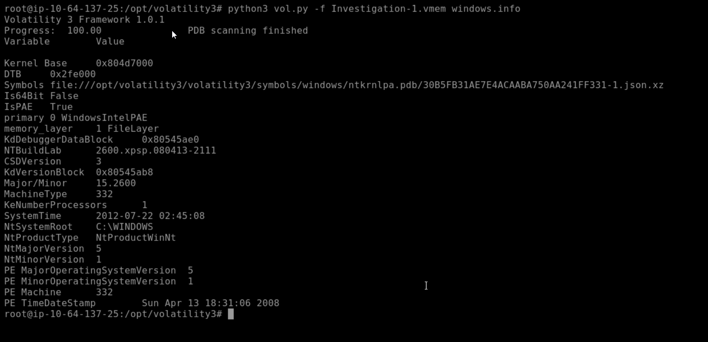
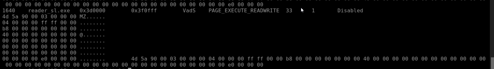
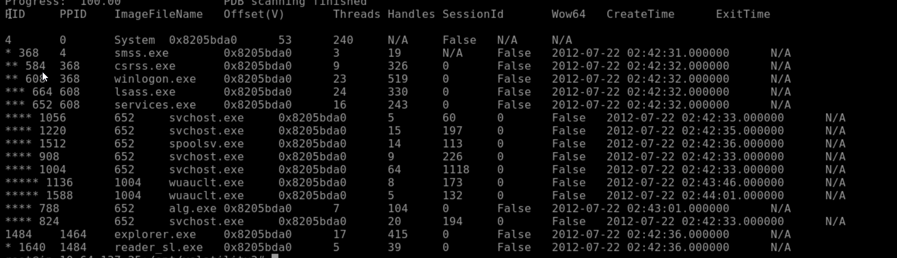
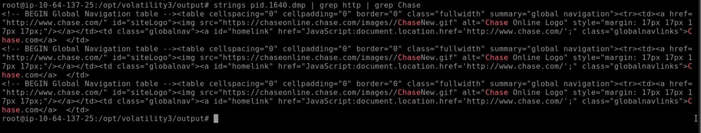
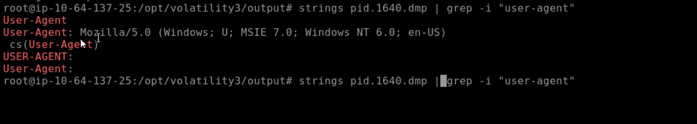
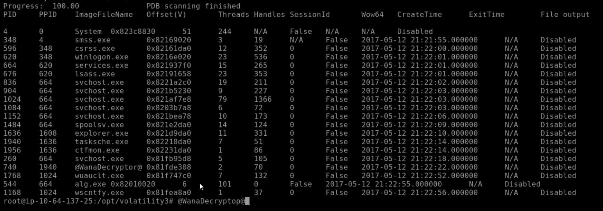
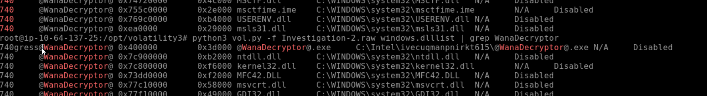
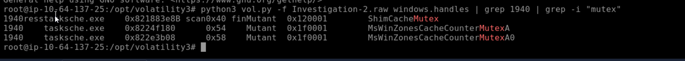

# Volatility Memory Forensics — Case Analysis

> **Memory Forensics Report** · TryHackMe · Two memory images analyzed with Volatility 3 — a banking trojan and a WannaCry infection.

## 1. Executive summary

This report analyzes two memory images acquired during security incidents. Investigation 1 involves suspected banking-trojan activity delivered through a malicious Adobe document. Investigation 2 involves a ransomware compromise consistent with WannaCry behavior. Volatility 3 was used to extract system details, identify suspicious processes, inspect loaded modules, analyze indicators of compromise, and attribute malware families. All referenced screenshots are in [`evidence/screenshots/`](evidence/screenshots/).

## 2. Tooling overview

The Volatility 3 Framework was installed and verified to perform analysis on both memory samples.



## 3. Investigation 1 — Banking trojan infection

### 3.1 Host machine information

- **Build version:** 2600.xpsp.080413-2111
- **System time:** 2012-07-22 02:45:08



### 3.2 Memory acquisition time

Acquisition timestamp from the memory metadata: **2012-07-22 02:45:08**.

### 3.3 Suspicious process identification

Suspicious process: **`reader_sl.exe`** (PID 1640).



### 3.4 Parent process identification

Parent process: `explorer.exe` (PID 1636).



### 3.5 Malicious network indicators

Memory strings show evidence of connections to banking-related domains including **Chase Online**, consistent with credential-harvesting activity.



### 3.6 User-agent used by the adversary

Extracted from memory:

```
Mozilla/5.0 (Windows; U; MSIE 7.0; Windows NT 6.0; en-US)
```



### 3.7 Bank domain confirmation

Chase Bank domain strings were found — **confirmed**.

## 4. Investigation 2 — Ransomware (WannaCry) infection

### 4.1 Suspicious process (PID 740)

A process clearly associated with WannaCry ransomware was identified: **`WanaDecryptor.exe`**.



### 4.2 Full binary path

```
C:\Intel\ivecucqmanpnirkt615\WanaDecryptor@.exe
```



### 4.3 Parent process identification (PID 740)

Parent process: `tasksche.exe` (PID 1940).

### 4.4 Decryptor-related suspicious parent process

Suspicious parent PID **1940** — aligns with WannaCry behavior, where `tasksche.exe` is abused for persistence.

### 4.5 Malware attribution

Based on process name, directory structure, mutexes, and DLL loads, the malware present is **WannaCry ransomware**.

### 4.6 DLL loaded for socket creation

Networking DLLs loaded by the decryptor process include **`ws2_32.dll`** (Windows Sockets), supporting malware C2 communication.

### 4.7 Mutex identified

Mutexes identified: `ShimCacheMutex`, `MsWinZonesCacheCounterMutexA`, `MsWinZonesCacheCounterMutexA0` — known indicators of WannaCry variants.



### 4.8 Plugin to enumerate loaded files

Recommended plugin: **`windows.filescan`** — enumerates all file objects present in memory, including working-directory artifacts.

## 5. Conclusion

Investigation 1 confirms a banking trojan executed via Adobe Reader, using `reader_sl.exe` as the malicious process. The adversary connected to banking sites, likely harvesting credentials, and used a Windows-native user-agent to blend with normal traffic.

Investigation 2 confirms the presence of WannaCry ransomware, including the decryptor binary, identifying mutexes associated with this malware family, and modules required for network communication. The malicious binary and process tree match known indicators of the WannaCry campaign.

Both memory dumps demonstrate clear malicious activity and provide strong forensic evidence of compromise.

## Indicators of compromise

| Case | Type | Indicator |
|---|---|---|
| 1 | Process | `reader_sl.exe` (PID 1640, parent `explorer.exe`) |
| 1 | User-agent | `MSIE 7.0; Windows NT 6.0` |
| 2 | Process | `WanaDecryptor.exe` (PID 740, parent `tasksche.exe` PID 1940) |
| 2 | Path | `C:\Intel\ivecucqmanpnirkt615\WanaDecryptor@.exe` |
| 2 | Mutexes | `MsWinZonesCacheCounterMutexA`, `ShimCacheMutex` |
| 2 | DLL | `ws2_32.dll` |

---

*Originally published at `github.com/hordiikorol/volatility-memory-forensics`.*
